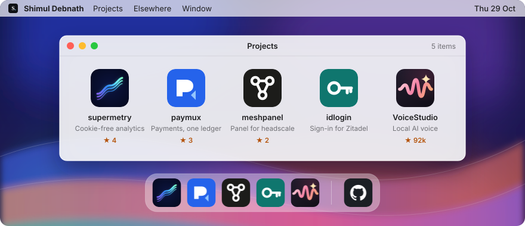

<picture>
  <source media="(prefers-color-scheme: dark)" srcset="assets/desktop-dark.svg">
  
</picture>

  <a href="https://github.com/velixio/supermetry">supermetry</a> ·
  <a href="https://github.com/velixio/paymux">paymux</a> ·
  <a href="https://github.com/velixio/meshpanel">meshpanel</a> ·
  <a href="https://github.com/velixio/idlogin">idlogin</a> ·
  <a href="https://github.com/debpalash/VoiceStudio">VoiceStudio</a> ·
  <a href="https://shimul.me">shimul.me</a>

  

