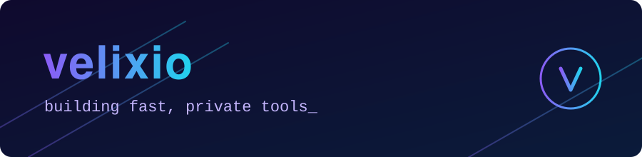

## Hi, I'm Shimul 👋

I write software that is quick to run, easy to host, and doesn't spy on anyone. Mostly Go, mostly small, always self-hostable.

### What I'm working on

**[supermetry](https://github.com/velixio/supermetry)** is web analytics without the baggage. No cookies, no consent banners, no third-party trackers. It ships as one Go binary and uses PostgreSQL for storage.

### Tools I reach for

### How I like to build

1. Ship one binary instead of ten services.
2. Collect only the data you need.
3. Keep it fast without extra effort.

---

Found a bug or have an idea? [Open an issue](https://github.com/velixio/supermetry/issues). I read them all.
