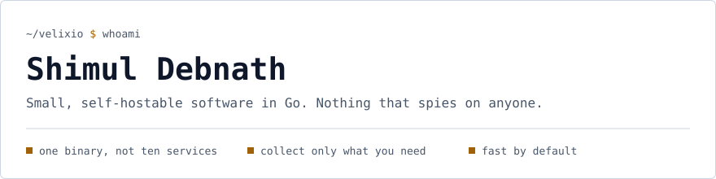
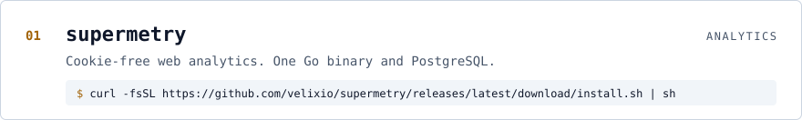
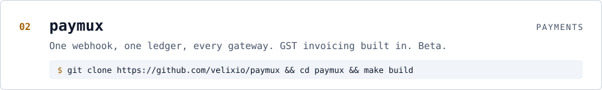
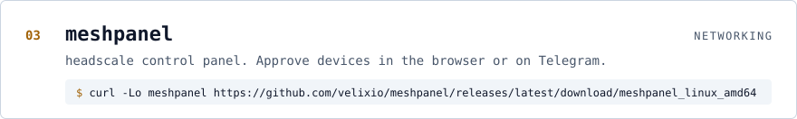
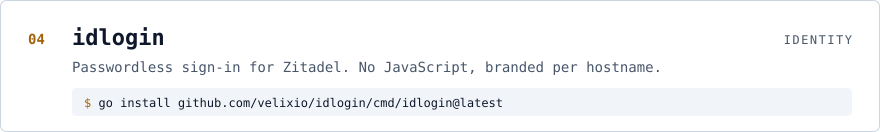
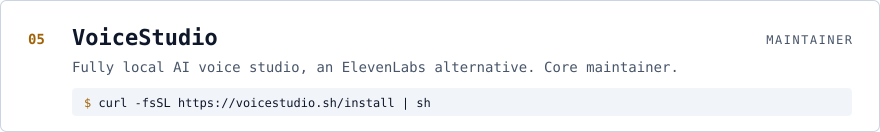

<picture>
  <source media="(prefers-color-scheme: dark)" srcset="assets/header-dark.svg">
  
</picture>

<a href="https://github.com/velixio/supermetry">
<picture>
  <source media="(prefers-color-scheme: dark)" srcset="assets/supermetry-dark.svg">
  
</picture>
</a>

 

<a href="https://github.com/velixio/paymux">
<picture>
  <source media="(prefers-color-scheme: dark)" srcset="assets/paymux-dark.svg">
  
</picture>
</a>

 

<a href="https://github.com/velixio/meshpanel">
<picture>
  <source media="(prefers-color-scheme: dark)" srcset="assets/meshpanel-dark.svg">
  
</picture>
</a>

  

<a href="https://github.com/velixio/idlogin">
<picture>
  <source media="(prefers-color-scheme: dark)" srcset="assets/idlogin-dark.svg">
  
</picture>
</a>

 

<a href="https://github.com/debpalash/VoiceStudio">
<picture>
  <source media="(prefers-color-scheme: dark)" srcset="assets/voicestudio-dark.svg">
  
</picture>
</a>

  

Found a bug or have an idea? Open an issue on the project's repo. I read them all.

